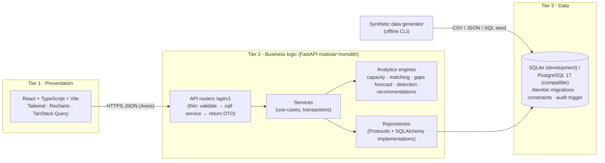
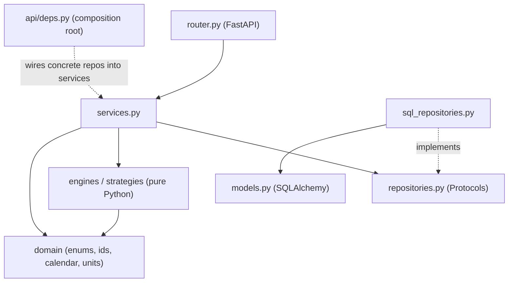
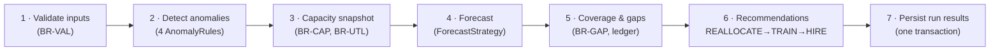

# 04 — Architecture

## 1. The big picture (beginner-friendly)

WorkforceIQ is split into **three tiers**. Each tier talks only to the one next to it.



- **Presentation tier** — the web pages. It never touches the database; it only calls the REST API.
- **Business tier** — all rules live here. FastAPI receives a request, a *service* performs the
  use-case, *engines* do the calculations, *repositories* read/write the database.
- **Data tier** — a relational database stores records with keys and constraints; Alembic
  versions the schema. Development uses **SQLite** (a single file, nothing to install); the same
  schema and migration run on **PostgreSQL 17** by setting `WFIQ_DB_BACKEND=postgresql`
  (decision A-35).

**Modular monolith** means one deployable backend, internally divided into modules with clear
boundaries — simpler than microservices but still organised.

## 2. Backend modules

| Module | Owns (tables) | Responsibility |
|---|---|---|
| `workforce` | employee, role, skill, role_skill, employee_skill, availability, training | People, skills, schedules, leave, training |
| `projects` | project, demand_plan, demand_skill_requirement, demand_actual, allocation | Projects, demand lines, actuals, allocations |
| `analytics` | analysis_run, capacity_snapshot, forecast_result, gap_analysis, recommendation, recommendation_gap_link, exception_finding | Capacity, matching, gaps, forecasts, anomaly detection, recommendations |
| `reporting` | (read-only views over the above) | Dashboard metrics, reports, audit history |
| `core` | — | Settings, DB engine/session (`core/database.py`), logging, error handling |
| `db` (shared persistence) | audit_event, id_sequence, dataset_metadata | Declarative base + naming convention, portable column types, CHECK builders, immutability guard, generic repository, audit recorder, ID allocator, model registry, data-dictionary generator |
| `domain` (shared kernel) | — | Enums, ID formats, ISO-week calendar, hour/FTE units, lifecycles, domain errors, rule-config loader — pure Python, no FastAPI or SQLAlchemy imports |

Modules may import `core` and `domain`. A module uses another module only through its **service
or repository protocol**, never through its ORM models directly.

Inside each module:

```
modules/<name>/
  models.py        SQLAlchemy ORM classes (structure only — no business logic)
  schemas.py       Pydantic v2 request/response DTOs
  repositories.py  Protocols (interfaces) the services depend on
  sql_repositories.py  SQLAlchemy implementations of those Protocols
  services.py      Use-cases; depend on Protocols, receive them via constructor
  router.py        FastAPI routes; thin
```

The `analytics` module adds `engines/` (pure calculation classes operating on plain dataclasses)
and `strategies/` (forecast and recommendation strategies).

## 3. Layering and the dependency rule



Arrows point from *user* to *used*. Services and engines never import SQLAlchemy or FastAPI.
The only place that knows about concrete classes is the **composition root** (`api/deps.py`),
which FastAPI's `Depends()` uses to build services per request.

## 4. SOLID — where each principle is applied

| Principle | Concrete application |
|---|---|
| **S**ingle responsibility | Separate classes: `CapacityCalculator`, `SkillStatusEvaluator`, `EligibilityPolicy`, `CoverageMatcher`, `GapAnalyzer`, `RecommendationEngine`, `ForecastEngine`, one detector class per anomaly rule, repositories for persistence only, routers for HTTP only. |
| **O**pen/closed | `ForecastStrategy` (NAIVE_PLAN, MOVING_AVERAGE, PLAN_RATIO), `RecommendationStrategy` (REALLOCATE, TRAIN, HIRE) and `AnomalyRule` (four detectors) are registries. A new strategy is a new class + one registry entry; the engines are not edited. |
| **L**iskov substitution | Every strategy honours the same contract (e.g. a recommendation strategy may only *reduce* residual gap hours, never debits more ledger hours than available, is deterministic). A **shared parametrised contract test suite** runs against every implementation. |
| **I**nterface segregation | Small Protocols instead of "god repositories": `EmployeeReader`, `EmployeeWriter`, `CapacityInputsReader`, `ActualsReader` (only `before=` queries), `RunResultWriter`, `AuditWriter`… A service depends only on what it uses. |
| **D**ependency inversion | Services receive Protocols in their constructors. Production wiring uses SQLAlchemy implementations; unit tests use in-memory fakes — no database needed to test business logic. |

## 5. Request lifecycle

```mermaid
sequenceDiagram
    participant B as Browser
    participant MW as Middleware
    participant R as Router
    participant S as Service
    participant Repo as Repository
    participant DB as PostgreSQL
    B->>MW: POST /api/v1/allocations (JSON)
    MW->>MW: assign X-Request-ID, start timer
    MW->>R: request
    R->>R: Pydantic validates body (422 on error)
    R->>S: create_allocation(dto, actor)
    S->>Repo: load capacity inputs (employee, schedules, leave, allocations)
    S->>S: rules BR-ALC-001/003/005, BR-UTL-004
    alt rule violated and no override_reason
        S-->>R: raise BusinessRuleViolation (→ 409)
    else ok
        S->>Repo: insert allocation + audit_event (same transaction)
        Repo->>DB: INSERT … ; COMMIT
        S-->>R: AllocationRead
    end
    R-->>MW: 201 Created
    MW->>MW: JSON log line (request_id, status, duration_ms)
    MW-->>B: response + X-Request-ID
```

## 6. Analytics pipeline



Detection runs **before** gap analysis so duplicate demand lines can be excluded from totals
(BR-DEM-004). Each run is an `analysis_run` row; all outputs carry its `run_id`, the rules version
and the SHA-256 of the rules file.

### Implemented in Phase 2 (persistence)

| Piece | File | Principle |
|---|---|---|
| Repository Protocols `Reader`, `Lister`, `Writer` | `app/db/repository.py` | ISP — callers depend on the smallest interface |
| Generic `SqlAlchemyRepository[Model]` | `app/db/repository.py` | DIP — the only place that knows SQLAlchemy queries |
| Workforce Protocols `ExistenceChecker`, `SkillCatalog`, `EmployeeSkillRepository` | `app/modules/workforce/repositories.py` | ISP |
| `EmployeeSkillService` (versioned skills, BR-SKL-008/005) | `app/modules/workforce/services.py` | SRP + DIP — tested both with SQLite and with in-memory fakes |
| `AuditRecorder` / `IdAllocator` Protocols + SQL implementations | `app/db/audit.py`, `app/db/ids.py` | DIP |
| Immutability guard | `app/db/guards.py` | SRP — one cross-cutting rule in one place |

ORM models contain structure only (columns, keys, constraints, relationships); relationships are
declared only *within* a module, foreign keys may cross modules.

## 7. Cross-cutting concerns

| Concern | Approach |
|---|---|
| Configuration | `pydantic-settings` reads `WFIQ_*` environment variables / `.env`; business rules from `business_rules.toml`. No credentials in code. |
| Transactions | One SQLAlchemy `Session` per request (unit of work): commit on success, rollback on any exception. An analysis run writes all results in one transaction; its `FAILED` status is recorded in a separate transaction. |
| Errors | Domain exceptions (`NotFoundError`, `ConflictError`, `BusinessRuleViolation`, `InvalidStateTransition`) mapped centrally to HTTP 404/409/409/422. One response shape: `{"error": {"code", "message", "details", "request_id"}}`. |
| Logging | Standard-library `logging` with a JSON formatter: timestamp, level, logger, message, request_id, plus extras. Access log per request with duration. |
| Pagination / filtering | `?page=1&page_size=50` (max 200) → `{items, page, page_size, total}`; filters as query parameters; `sort=field,-other`. |
| Audit | Every create/update/status change writes an `audit_event` (before/after JSON, actor, request_id) in the same transaction. A DB trigger rejects UPDATE/DELETE on `audit_event`. |
| Determinism | Engines sort inputs explicitly, use `Decimal`, never read the clock (dates come from `as_of_date`). |

## 8. API surface (designed now, implemented in Phase 4–5)

| Area | Endpoints (all under `/api/v1`) |
|---|---|
| Employees | `GET/POST /employees`, `GET/PATCH/DELETE /employees/{id}`, `GET /employees/{id}/skills`, `POST /employees/{id}/skills` |
| Skills & roles | `GET/POST /skills`, `GET/PATCH /skills/{id}`, `GET/POST /roles`, `GET /roles/{id}/skills` |
| Projects | `GET/POST /projects`, `GET/PATCH /projects/{id}`, `POST /projects/{id}/status` |
| Demand | `GET/POST /demand-plans`, `GET/PATCH /demand-plans/{id}`, `POST /demand-plans/{id}/status`, `GET /demand-actuals` |
| Allocations | `GET/POST /allocations`, `GET/PATCH /allocations/{id}`, `POST /allocations/{id}/status` |
| Availability | `GET/POST /availability`, `GET/PATCH /availability/{id}` |
| Training | `GET/POST /trainings`, `GET/PATCH /trainings/{id}` |
| Analysis | `POST /forecasts/runs`, `GET /forecasts/runs/{id}`, `GET /forecasts/results`, `GET /forecasts/evaluation`; `POST /gap-analysis/runs`, `GET /gap-analysis`; `POST /exceptions/runs`, `GET /exceptions`; `POST /analysis/runs` (full pipeline) |
| Capacity | `GET /capacity/employees`, `GET /capacity/summary` |
| Recommendations | `GET /recommendations`, `GET /recommendations/{id}`, `POST /recommendations/{id}/status` |
| Dashboard & reports | `GET /dashboard/metrics`, `GET /dashboard/demand-supply`, `GET /reports/{name}`, `GET /audit-events` |
| Health | `GET /health` |

## 9. Frontend (Phase 6)

React 18 + TypeScript + Vite, Tailwind CSS, React Router, TanStack Query (caching and loading
states) over an Axios client generated by hand from the OpenAPI schema, Recharts for charts.
Ten pages: Dashboard, Employees, Employee Skill Profiles, Projects, Demand Planning, Capacity &
Utilization, Skill Gap Analysis, Hiring & Training Recommendations, Exceptions & Anomalies,
Reports & Audit History.

## 10. Testing strategy

| Level | What | Database |
|---|---|---|
| Unit | Engines, strategies (shared contract tests), rules, ID formats, calendar, config | none (in-memory fakes) |
| Integration | Repositories, migrations, constraints, triggers, API endpoints via `TestClient` | disposable SQLite copies of a database migrated by Alembic once per session; live PostgreSQL tests run only when `WFIQ_TEST_PG_URL` points to a disposable database |
| Data | Generated files: PK/FK/enum/date/capacity/lifecycle checks (BR-VAL) | none |
| Reproducibility | Generate twice, compare row counts and SHA-256 | none |
| Evaluation | Detection vs ground truth (precision, recall, F1, confusion matrix); forecast MAE/WAPE/bias | DB or files |
