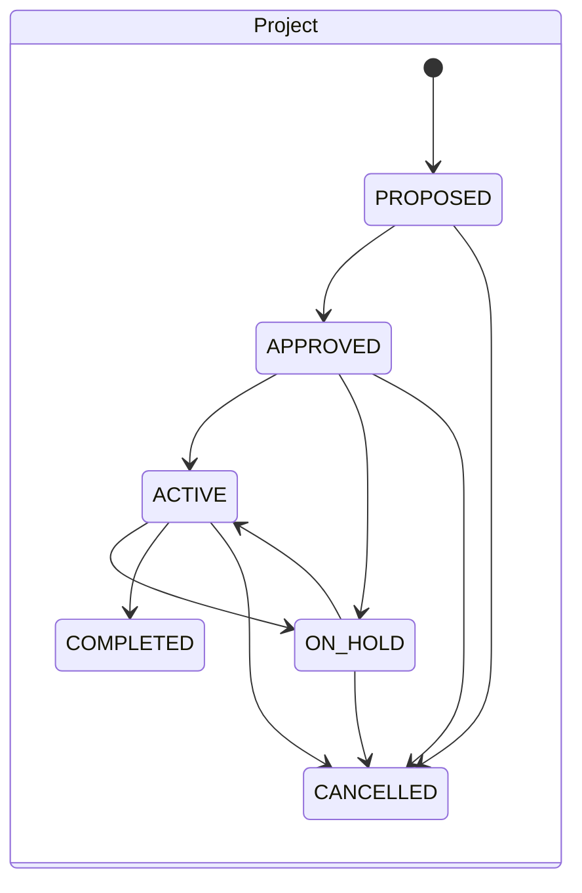
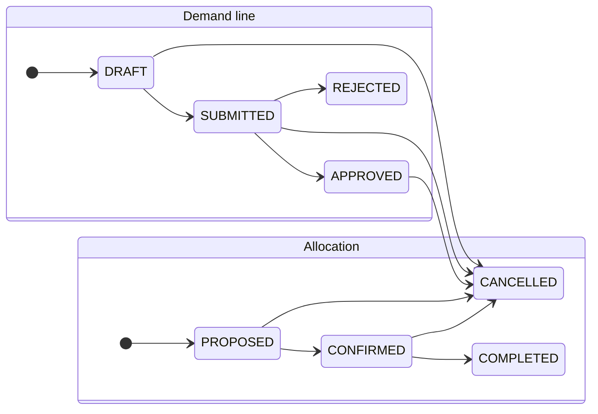

# 05 — Data Model and ER Diagram

This is the **logical** design. **Phase 2 implemented it** as 22 SQLAlchemy models
(`backend/app/modules/*/models.py`, `backend/app/db/models.py`) and the Alembic migration
`backend/migrations/versions/0001_initial_schema.py`. The column-level
**[data dictionary](07-data-dictionary.md) is generated from the code** and is the authoritative
reference for types, defaults and constraints. Implementation decisions and the small corrections
made to this document are listed in [02 — Phase 2 decisions](02-assumptions-and-decisions.md#phase-2-decisions-database-implementation).

Database engine: SQLite in development, PostgreSQL-compatible schema (A-35).

Conventions: table names are `snake_case` singular; text IDs are `VARCHAR`; hours are
`NUMERIC(7,2)`; dates are `DATE`; timestamps are `TIMESTAMPTZ` (UTC); enums are PostgreSQL
`VARCHAR` + `CHECK` constraints (easy to evolve with Alembic). Every business table has
`created_at` and `updated_at`. All foreign keys use `ON DELETE RESTRICT` (history is never deleted
by cascade). **R** = required (NOT NULL), **O** = optional.

## 1. ER diagram

```mermaid
erDiagram
    ROLE ||--o{ EMPLOYEE : "primary role of"
    ROLE ||--o{ ROLE_SKILL : "expects"
    SKILL ||--o{ ROLE_SKILL : "expected by"
    EMPLOYEE ||--o{ EMPLOYEE_SKILL : "holds"
    SKILL ||--o{ EMPLOYEE_SKILL : "held as"
    EMPLOYEE ||--o{ AVAILABILITY : "has schedule/leave"
    EMPLOYEE ||--o{ ALLOCATION : "is allocated"
    PROJECT ||--o{ ALLOCATION : "staffed by"
    ROLE ||--o{ ALLOCATION : "played in"
    PROJECT ||--o{ DEMAND_PLAN : "requires"
    ROLE ||--o{ DEMAND_PLAN : "requested as"
    DEMAND_PLAN ||--|{ DEMAND_SKILL_REQUIREMENT : "needs"
    SKILL ||--o{ DEMAND_SKILL_REQUIREMENT : "needed by"
    PROJECT ||--o{ DEMAND_ACTUAL : "consumed"
    ROLE ||--o{ DEMAND_ACTUAL : "consumed as"
    EMPLOYEE ||--o{ TRAINING : "attends"
    SKILL ||--o{ TRAINING : "taught in"
    RECOMMENDATION |o--o{ TRAINING : "implemented by"
    TRAINING |o--o| EMPLOYEE_SKILL : "produces version"
    ANALYSIS_RUN ||--o{ CAPACITY_SNAPSHOT : "computes"
    EMPLOYEE ||--o{ CAPACITY_SNAPSHOT : "measured in"
    ANALYSIS_RUN ||--o{ FORECAST_RESULT : "produces"
    PROJECT ||--o{ FORECAST_RESULT : "forecast for"
    ROLE ||--o{ FORECAST_RESULT : "forecast as"
    ANALYSIS_RUN ||--o{ GAP_ANALYSIS : "produces"
    PROJECT ||--o{ GAP_ANALYSIS : "gap in"
    ROLE ||--o{ GAP_ANALYSIS : "gap for"
    SKILL ||--o{ GAP_ANALYSIS : "gap of"
    ANALYSIS_RUN ||--o{ RECOMMENDATION : "produces"
    ROLE ||--o{ RECOMMENDATION : "for role"
    SKILL ||--o{ RECOMMENDATION : "for skill"
    EMPLOYEE |o--o{ RECOMMENDATION : "subject of"
    PROJECT |o--o{ RECOMMENDATION : "benefits"
    RECOMMENDATION ||--|{ RECOMMENDATION_GAP_LINK : "addresses"
    GAP_ANALYSIS ||--o{ RECOMMENDATION_GAP_LINK : "addressed by"
    ANALYSIS_RUN ||--o{ EXCEPTION_FINDING : "detects"

    ROLE {
        varchar role_id PK "ROL-000001"
        varchar code UK
        varchar name UK
        varchar role_family
        boolean is_active
    }
    SKILL {
        varchar skill_id PK "SKL-000001"
        varchar code UK
        varchar name UK
        varchar category
        boolean requires_certification
        smallint validity_months
    }
    ROLE_SKILL {
        varchar role_id PK,FK
        varchar skill_id PK,FK
        varchar importance
        smallint typical_min_proficiency
    }
    EMPLOYEE {
        varchar employee_id PK "EMP-000001"
        varchar email UK
        varchar role_id FK
        varchar seniority
        date hire_date
        date termination_date
        varchar status
    }
    EMPLOYEE_SKILL {
        varchar employee_skill_id PK "ESK-000001"
        varchar employee_id FK
        varchar skill_id FK
        smallint proficiency_level
        date last_verified_date
        date expiry_date
        varchar recorded_status
        date effective_from
        date effective_to
    }
    AVAILABILITY {
        varchar availability_id PK "AVL-2026-000001"
        varchar employee_id FK
        varchar availability_type
        date start_date
        date end_date
        numeric weekly_hours
        numeric hours_per_day
        varchar status
    }
    PROJECT {
        varchar project_id PK "PRJ-2026-000001"
        varchar name
        varchar priority
        varchar status
        date start_date
        date end_date
    }
    DEMAND_PLAN {
        varchar demand_id PK "DEM-PRJ-2026-000001-2026W01-01"
        varchar project_id FK
        varchar role_id FK
        smallint iso_year
        smallint iso_week
        date week_start_date
        smallint line_no
        numeric required_hours
        smallint headcount
        varchar status
    }
    DEMAND_SKILL_REQUIREMENT {
        varchar demand_id PK,FK
        varchar skill_id PK,FK
        varchar requirement_type
        smallint min_proficiency
    }
    DEMAND_ACTUAL {
        varchar project_id PK,FK
        varchar role_id PK,FK
        date week_start_date PK
        numeric actual_hours
    }
    ALLOCATION {
        varchar allocation_id PK "ALLOC-2026-000001"
        varchar employee_id FK
        varchar project_id FK
        varchar role_id FK
        date start_date
        date end_date
        numeric hours_per_week
        varchar allocation_type
        varchar status
    }
    TRAINING {
        varchar training_id PK "TRN-2026-000001"
        varchar employee_id FK
        varchar skill_id FK
        varchar recommendation_id FK
        varchar outcome_employee_skill_id FK
        varchar training_type
        smallint target_proficiency
        date start_date
        date end_date
        numeric hours_per_week
        varchar status
    }
    ANALYSIS_RUN {
        varchar run_id PK "RUN-2026-000001"
        varchar run_type
        varchar status
        date as_of_date
        date period_start
        date period_end
        varchar rules_version
        char rules_sha256
        jsonb parameters
        jsonb summary
    }
    CAPACITY_SNAPSHOT {
        varchar run_id PK,FK
        varchar employee_id PK,FK
        date week_start_date PK
        numeric gross_hours
        numeric leave_hours
        numeric training_hours
        numeric net_hours
        numeric allocated_hours
        numeric free_hours
        varchar risk_band
    }
    FORECAST_RESULT {
        varchar run_id PK,FK
        varchar method PK
        varchar project_id PK,FK
        varchar role_id PK,FK
        date week_start_date PK
        numeric planned_hours
        numeric forecast_hours
    }
    GAP_ANALYSIS {
        varchar gap_id PK "GAP-000001-000001"
        varchar run_id FK
        varchar project_id FK
        varchar role_id FK
        varchar skill_id FK
        date week_start_date
        numeric demand_hours
        numeric committed_hours
        numeric at_risk_hours
        numeric gap_hours
        numeric coverage_ratio
        varchar severity
    }
    RECOMMENDATION {
        varchar recommendation_id PK "REC-000001-000001"
        varchar run_id FK
        varchar recommendation_type
        varchar role_id FK
        varchar skill_id FK
        varchar employee_id FK
        varchar project_id FK
        numeric hours
        smallint headcount
        text explanation
        jsonb rule_ids
        jsonb source_refs
        varchar status
    }
    RECOMMENDATION_GAP_LINK {
        varchar recommendation_id PK,FK
        varchar gap_id PK,FK
        numeric covered_hours
    }
    EXCEPTION_FINDING {
        varchar finding_id PK "EXC-000001-000001"
        varchar run_id FK
        varchar anomaly_type
        varchar rule_id
        varchar entity_type
        varchar entity_id
        jsonb related_ids
        varchar severity
        varchar status
    }
    AUDIT_EVENT {
        bigint audit_id PK
        timestamptz occurred_at
        varchar actor
        varchar entity_type
        varchar entity_id
        varchar action
        jsonb before_state
        jsonb after_state
    }
    DATASET_METADATA {
        varchar key PK
        varchar value
    }
    ID_SEQUENCE {
        varchar prefix PK
        integer last_value
    }
```

`AUDIT_EVENT`, `DATASET_METADATA` and `ID_SEQUENCE` are intentionally standalone (polymorphic
reference by `entity_type` + `entity_id`; key/value metadata; ID counters).

## 2. Cardinality summary

| Relationship | Cardinality | Implemented by |
|---|---|---|
| Role → Employee (primary role) | 1 : N | `employee.role_id` |
| Role ↔ Skill | M : N | bridge `role_skill` |
| Employee ↔ Skill | M : N (versioned) | bridge `employee_skill` |
| Employee → Availability | 1 : N | `availability.employee_id` |
| Employee ↔ Project | M : N (dated) | bridge `allocation` (+ role) |
| Project → DemandPlan | 1 : N | `demand_plan.project_id` |
| DemandPlan ↔ Skill | M : N (exactly 1 PRIMARY) | bridge `demand_skill_requirement` |
| Project × Role → DemandActual | 1 : N (per week) | composite PK |
| Employee → Training; Skill → Training | 1 : N | FKs |
| Recommendation → Training | 0..1 : N | `training.recommendation_id` (optional) |
| Training → EmployeeSkill (outcome) | 0..1 : 0..1 | `training.outcome_employee_skill_id` |
| AnalysisRun → all result tables | 1 : N | `run_id` |
| Recommendation ↔ GapAnalysis | M : N | bridge `recommendation_gap_link` |

## 3. Entity specifications — 10 mandatory entities

### 3.1 Role
| Column | Type | R/O | Rules |
|---|---|---|---|
| role_id | varchar(10) PK | R | `ROL-\d{6}` |
| code | varchar(40) UK | R | upper snake case, e.g. `BACKEND_ENGINEER` |
| name | varchar(100) UK | R | |
| role_family | enum | R | ENGINEERING, DATA, CLOUD_INFRA, QUALITY, DESIGN, PRODUCT, DELIVERY, SECURITY |
| description | text | O | |
| is_active | boolean | R | default true; deactivate instead of delete |

History: audit events. Effective dating: not needed (reference data; deactivation only).

### 3.2 Skill
| Column | Type | R/O | Rules |
|---|---|---|---|
| skill_id | varchar(10) PK | R | `SKL-\d{6}` |
| code | varchar(60) UK | R | |
| name | varchar(120) UK | R | |
| category | enum | R | PROGRAMMING, DATA_ANALYTICS, CLOUD, DEVOPS, SECURITY, TESTING, DESIGN, MANAGEMENT, ARCHITECTURE, DOMAIN |
| requires_certification | boolean | R | default false |
| validity_months | smallint | O | 1–60; **required iff** `requires_certification` (CHECK) |
| is_active | boolean | R | |

### 3.3 Employee
| Column | Type | R/O | Rules |
|---|---|---|---|
| employee_id | varchar(10) PK | R | `EMP-\d{6}` |
| first_name, last_name | varchar(60) | R | synthetic |
| email | varchar(254) UK | R | `@example.com` in synthetic data |
| role_id | FK → role | R | primary role |
| seniority | enum | R | JUNIOR, MID, SENIOR, LEAD, PRINCIPAL |
| location | varchar(60) | R | synthetic city list |
| hire_date | date | R | |
| termination_date | date | O | `≥ hire_date` (CHECK) |
| status | enum | R | PENDING_START, ACTIVE, TERMINATED (BR-EMP-001) |

Lifecycle: `PENDING_START → ACTIVE → TERMINATED`. Effective dates: hire/termination dates;
working hours live in `availability` (A-06). Employment type FULL_TIME/PART_TIME is derived.
Delete: soft (status TERMINATED); hard delete only if no dependent rows.

### 3.4 EmployeeSkill (bridge, versioned)
| Column | Type | R/O | Rules |
|---|---|---|---|
| employee_skill_id | varchar(10) PK | R | `ESK-\d{6}` |
| employee_id | FK → employee | R | |
| skill_id | FK → skill | R | |
| proficiency_level | smallint | R | 1–5 (CHECK) |
| assessment_source | enum | R | SELF, MANAGER, ASSESSMENT, CERTIFICATION, TRAINING |
| last_verified_date | date | R | not in the future relative to `as_of_date` |
| expiry_date | date | O | `> last_verified_date`; required for certification skills (BR-SKL-005) |
| recorded_status | enum | R | CURRENT, EXPIRED, PENDING_VERIFICATION — source flag, **not trusted** (BR-SKL-003) |
| effective_from | date | R | |
| effective_to | date | O | null = current version; `≥ effective_from` |

Unique partial index: `(employee_id, skill_id) WHERE effective_to IS NULL` (BR-SKL-008).
Derived (not stored): effective status VALID / STALE / PENDING / EXPIRED (BR-SKL-002).

### 3.5 Project
| Column | Type | R/O | Rules |
|---|---|---|---|
| project_id | varchar(15) PK | R | `PRJ-\d{4}-\d{6}` |
| name | varchar(150) | R | |
| client_name | varchar(150) | O | synthetic |
| business_unit | varchar(60) | R | |
| priority | enum | R | CRITICAL, HIGH, MEDIUM, LOW |
| status | enum | R | PROPOSED, APPROVED, ACTIVE, ON_HOLD, COMPLETED, CANCELLED (BR-PRJ-001) |
| start_date, end_date | date | R | `start ≤ end` |
| closed_date | date | O | set when COMPLETED/CANCELLED; `≥ start_date` |

### 3.6 DemandPlan (one weekly demand line)
| Column | Type | R/O | Rules |
|---|---|---|---|
| demand_id | varchar(40) PK | R | `DEM-<project_id>-<YYYY>W<WW>-<NN>` |
| project_id | FK → project | R | |
| role_id | FK → role | R | |
| iso_year, iso_week | smallint | R | week 1–53 and valid for the ISO year |
| week_start_date | date | R | = Monday of (iso_year, iso_week) — enforced in the domain layer (correction C-1) |
| line_no | smallint | R | 1–99; UNIQUE (project_id, iso_year, iso_week, line_no) |
| required_hours | numeric(7,2) | R | `> 0`; `≤ headcount × 40` |
| headcount | smallint | R | `≥ 1` |
| status | enum | R | DRAFT, SUBMITTED, APPROVED, REJECTED, CANCELLED (BR-DEM-002) |
| source | enum | R | PROJECT_PLAN, MANUAL, IMPORT |

The business key (project, week, role, primary skill, min proficiency) is deliberately **not**
unique in the DB — duplicates are detected (BR-DEM-004, A-15/A-17).

### 3.7 Allocation (bridge Employee ↔ Project, dated)
| Column | Type | R/O | Rules |
|---|---|---|---|
| allocation_id | varchar(17) PK | R | `ALLOC-\d{4}-\d{6}` |
| employee_id | FK → employee | R | |
| project_id | FK → project | R | |
| role_id | FK → role | R | role played on the project |
| start_date, end_date | date | R | `start ≤ end` (CHECK) |
| hours_per_week | numeric(5,2) | R | `0 < h ≤ 60` (CHECK) |
| allocation_type | enum | R | DEDICATED (exclusive), SHARED |
| status | enum | R | PROPOSED, CONFIRMED, COMPLETED, CANCELLED (BR-ALC-002) |
| notes | text | O | |

Over-allocation and overlap are **not** prevented by the DB (they are detected); the API guards
interactive writes (BR-ALC-005).

### 3.8 Availability (work schedules and leave, dated)
| Column | Type | R/O | Rules |
|---|---|---|---|
| availability_id | varchar(15) PK | R | `AVL-\d{4}-\d{6}` |
| employee_id | FK → employee | R | |
| availability_type | enum | R | WORK_SCHEDULE, ANNUAL_LEAVE, SICK_LEAVE, PARENTAL_LEAVE, UNPAID_LEAVE, OTHER_ABSENCE |
| start_date | date | R | |
| end_date | date | O for WORK_SCHEDULE (open-ended), R for leave | `≥ start_date` |
| weekly_hours | numeric(5,2) | R iff WORK_SCHEDULE | 8–40 (BR-CAP-004) |
| hours_per_day | numeric(4,2) | O, leave only | null = full day; `0 < h ≤ 8` |
| status | enum | R | REQUESTED, APPROVED, REJECTED, CANCELLED (schedules are APPROVED) |
| reason | varchar(200) | O | |

No two non-cancelled WORK_SCHEDULE rows of the same employee may overlap (BR-VAL-009): enforced by
triggers on SQLite and an exclusion constraint (`btree_gist`) on PostgreSQL. Leave may overlap
(deduction is capped, BR-CAP-005).

### 3.9 Training
| Column | Type | R/O | Rules |
|---|---|---|---|
| training_id | varchar(15) PK | R | `TRN-\d{4}-\d{6}` |
| employee_id | FK → employee | R | |
| skill_id | FK → skill | R | |
| recommendation_id | FK → recommendation | O | set when created from a TRAIN recommendation |
| training_type | enum | R | COURSE, CERTIFICATION, RECERTIFICATION, MENTORING |
| target_proficiency | smallint | R | 1–5 |
| start_date, end_date | date | R | `start ≤ end` |
| hours_per_week | numeric(5,2) | R | `0 < h ≤ 40` |
| status | enum | R | PLANNED, IN_PROGRESS, COMPLETED, CANCELLED (BR-TRN-001) |
| completion_date | date | O | required iff COMPLETED; `≥ start_date` |
| outcome_employee_skill_id | FK → employee_skill | O | the skill version created on completion (BR-TRN-002) |

### 3.10 GapAnalysis (one row per run × project × role × primary skill × week)
| Column | Type | R/O | Rules |
|---|---|---|---|
| gap_id | varchar(17) PK | R | `GAP-<run seq 6>-<seq 6>` |
| run_id | FK → analysis_run | R | |
| project_id, role_id, skill_id | FKs | R | skill = primary skill |
| iso_year, iso_week, week_start_date | | R | |
| demand_hours | numeric(9,2) | R | `> 0` after de-duplication |
| committed_hours, at_risk_hours | numeric(9,2) | R | `≥ 0`; `committed ≤ demand` |
| gap_hours | numeric(9,2) | R | `= demand − committed` (CHECK) |
| coverage_ratio | numeric(6,4) | R | `committed / demand` |
| reallocated_hours, trained_hours, hire_hours, unresolved_hours | numeric(9,2) | R | sum = gap_hours (BR-REC-001) |
| severity | enum | R | NONE, LOW, MEDIUM, HIGH, CRITICAL (BR-GAP-006) |
| source_demand_ids | jsonb | R | demand lines aggregated into this row |

UNIQUE (run_id, project_id, role_id, skill_id, week_start_date). Rows are immutable once the run
succeeds.

## 4. Supporting entities

| Table | PK | Purpose | Key rules |
|---|---|---|---|
| role_skill | (role_id, skill_id) | Skills expected for a role | importance CORE / SUPPORTING; typical_min_proficiency 1–5 |
| demand_skill_requirement | (demand_id, skill_id) | Skills a demand line needs | requirement_type PRIMARY / SECONDARY; min_proficiency 1–5; partial unique index on `demand_id WHERE requirement_type='PRIMARY'` |
| demand_actual | (project_id, role_id, week_start_date) | Synthetic timesheet actuals | actual_hours ≥ 0; forecast methods may read only weeks before origin (BR-FCT-004) |
| analysis_run | run_id `RUN-<as_of year>-<seq 6>` | One execution of forecast / gaps / detection / pipeline | run_type FORECAST, GAP_ANALYSIS, EXCEPTION_DETECTION, FULL_PIPELINE; status RUNNING → SUCCEEDED / FAILED; stores parameters, rules_version, rules_sha256, summary metrics |
| capacity_snapshot | (run_id, employee_id, week_start_date) | Per employee-week capacity facts | identity BR-CAP-009 enforced by CHECK; risk_band per BR-UTL-002 |
| forecast_result | (run_id, method, project_id, role_id, week_start_date) | Forecast values | method NAIVE_PLAN / MOVING_AVERAGE / PLAN_RATIO |
| recommendation | `REC-<run seq>-<seq>` | Explainable action | type REALLOCATE / TRAIN / HIRE; hire_type PERMANENT / CONTRACT (HIRE only); status PROPOSED → ACCEPTED / REJECTED → IMPLEMENTED; rule_ids, explanation, assumptions, source_refs (BR-REC-005) |
| recommendation_gap_link | (recommendation_id, gap_id) | Which gap rows a recommendation addresses | covered_hours > 0 |
| exception_finding | `EXC-<run seq>-<seq>` | Detected anomaly | anomaly_type (4 evaluated types + informational, e.g. STALE_SKILL); rule_id; severity LOW–CRITICAL; status OPEN → ACKNOWLEDGED → RESOLVED / DISMISSED |
| audit_event | audit_id BIGINT identity | Immutable change history | action CREATE / UPDATE / STATUS_CHANGE / DELETE; before/after JSONB; actor; request_id; reason; trigger blocks UPDATE/DELETE |
| dataset_metadata | key | Seed, mode, as_of_date, horizon, generator version, manifest hash | written by the seed loader |
| id_sequence | prefix | Last issued number per ID prefix (added in Phase 2, A-38) | last_value ≥ 0 |

## 5. ID conventions

| Entity | Pattern | Example | Number source |
|---|---|---|---|
| Employee | `EMP-{6}` | EMP-000001 | global sequence |
| Role | `ROL-{6}` | ROL-000001 | global sequence |
| Skill | `SKL-{6}` | SKL-000001 | global sequence |
| EmployeeSkill | `ESK-{6}` | ESK-000001 | global sequence |
| Project | `PRJ-{start year}-{6}` | PRJ-2026-000001 | global sequence |
| DemandPlan | `DEM-{project_id}-{ISO year}W{ISO week 2}-{line 2}` | DEM-PRJ-2026-000001-2026W01-01 | per project-week line counter |
| Allocation | `ALLOC-{start year}-{6}` | ALLOC-2026-000001 | global sequence |
| Availability | `AVL-{start year}-{6}` | AVL-2026-000001 | global sequence |
| Training | `TRN-{start year}-{6}` | TRN-2026-000001 | global sequence |
| AnalysisRun | `RUN-{as_of year}-{6}` | RUN-2026-000001 | global sequence |
| GapAnalysis / Recommendation / ExceptionFinding | `GAP/REC/EXC-{run seq 6}-{6}` | GAP-000001-000042 | per-run counter in deterministic output order |
| Ground truth (file only) | `GT-{6}` | GT-000001 | generator order |

Rules (A-27, A-28, A-38, A-41, BR-VAL-007): IDs are assigned once and never change (ORM guard);
the year segment records the start year at creation; the generator assigns numbers in a
deterministic generation order and then raises `id_sequence` past the highest seeded value so
API-created records continue the series. Zero padding makes text order equal numeric order within a prefix and year.

## 6. Lifecycles

| Entity | Transitions | Terminal |
|---|---|---|
| Employee | PENDING_START → ACTIVE → TERMINATED | TERMINATED |
| Availability | REQUESTED → APPROVED / REJECTED; REQUESTED, APPROVED → CANCELLED | REJECTED, CANCELLED |
| Training | PLANNED → IN_PROGRESS → COMPLETED; PLANNED, IN_PROGRESS → CANCELLED | COMPLETED, CANCELLED |
| AnalysisRun | RUNNING → SUCCEEDED / FAILED | both |
| Recommendation | PROPOSED → ACCEPTED / REJECTED; ACCEPTED → IMPLEMENTED | REJECTED, IMPLEMENTED |
| ExceptionFinding | OPEN → ACKNOWLEDGED → RESOLVED / DISMISSED; OPEN → RESOLVED / DISMISSED | RESOLVED, DISMISSED |

Invalid transitions raise `InvalidStateTransition` (HTTP 409); each valid transition writes an
`audit_event` with action `STATUS_CHANGE`.

## 7. History strategy

| Mechanism | Used for |
|---|---|
| Effective-dated rows | availability (schedules, leave), allocation, training, demand weeks, employee employment dates |
| Versioned rows (SCD type 2) | employee_skill |
| Immutable run snapshots | capacity_snapshot, forecast_result, gap_analysis, recommendation, exception_finding |
| Append-only audit log | every create/update/status change of every business table |
| No hard deletes | referenced records are deactivated / cancelled / terminated |

## 8. Planned indexes

| Table | Index | Supports |
|---|---|---|
| employee | role_id; status | filters, eligibility |
| employee_skill | (skill_id, proficiency_level) WHERE effective_to IS NULL; employee_id | matching, profiles |
| availability | (employee_id, start_date, end_date); availability_type | capacity |
| allocation | (employee_id, start_date, end_date); (project_id, role_id); status | capacity, overlap, coverage |
| demand_plan | (project_id, week_start_date); (role_id, week_start_date); status | gaps, duplicates |
| demand_actual | (role_id, week_start_date) | forecasting |
| gap_analysis | (run_id, week_start_date); (run_id, role_id, skill_id) | dashboards |
| recommendation | (run_id, recommendation_type); status | recommendations page |
| exception_finding | (run_id, anomaly_type); (entity_type, entity_id) | exceptions page |
| audit_event | (entity_type, entity_id, occurred_at) | audit history |
